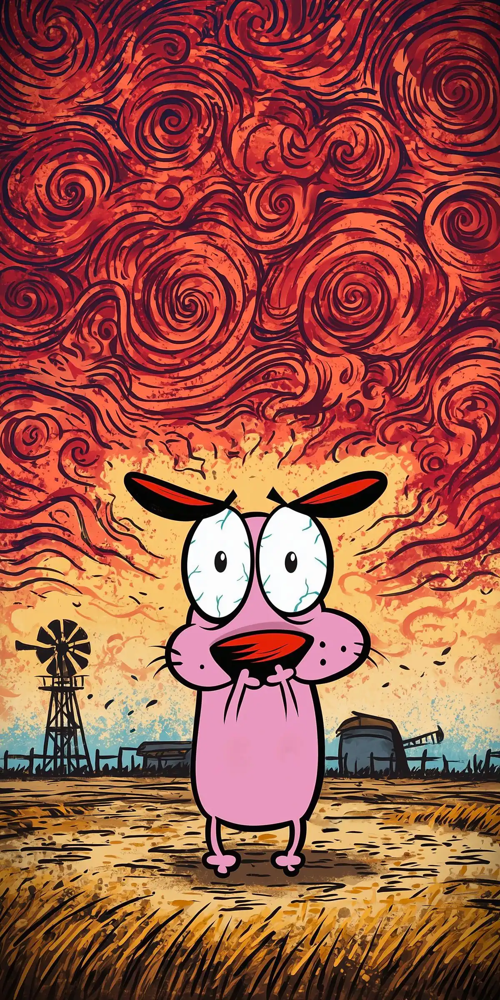

	

		<a class="card-portada" href="https://google.com" target="_blank">
			
			item 1
		</a>
		<a class="card-portada" href="https://google.com" target="_blank">
			
			item 1
		</a>
		<a class="card-portada" href="https://google.com" target="_blank">
			
			item 1
		</a>
		<a class="card-portada" href="https://google.com" target="_blank">
			
			item 1
		</a>
	

